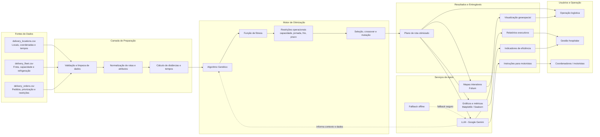

# 🚚 Tech Challenge — Fase 2
## Otimização de Rotas para Distribuição de Medicamentos e Insumos Hospitalares

Projeto desenvolvido como parte do **Tech Challenge** da Pós-Graduação em IA para Devs da FIAP, turma 11IADT, com foco no **Problema de Roteamento de Veículos (VRP)** utilizando **Algoritmos Genéticos (AG)** e **Large Language Models (LLMs)** para geração automatizada de instruções operacionais, relatórios de eficiência e suporte em linguagem natural.

O projeto estende o código base do problema do Caixeiro Viajante (TSP) para uma frota heterogênea de veículos com restrições operacionais complexas do setor hospitalar (capacidade de carga, autonomia de turno, jornada de trabalho, cadeia de frio e janelas de prioridade). Além disso, integra uma LLM (**Google Gemini** / templates determinísticos offline) para gerar instruções aos motoristas, relatórios gerenciais e responder a dúvidas sobre as rotas.

O vídeo explicativo da Fase 2 pode ser visto em: https://www.youtube.com/watch?v=

> ⚠️ **Aviso acadêmico:** este projeto tem finalidade educacional e experimental. As rotas, frotas e pedidos foram sintetizados para fins de modelagem e validação das técnicas.

---

## 🎯 Objetivo

O objetivo principal é solucionar os desafios logísticos de um Centro de Distribuição (CD) hospitalar em São Paulo, otimizando a distribuição de medicamentos e insumos entre unidades de saúde (hospitais, UBS, AMA) e pacientes em atendimento domiciliar.

As metas técnicas incluem:

- **Evolução do TSP para VRP:** adaptar a representação cromossômica e os operadores genéticos para suportar múltiplos veículos;
- **Modelagem de Restrições Reais:** incorporar penalidades e critérios operacionais na função de *fitness*;
- **Cadeia de Frio e Prioridades:** garantir atendimento prioritário para entregas críticas (até 09:00) e alocação estrita de itens refrigerados (2 °C a 8 °C) em veículos com refrigeração;
- **Benchmarking de Algoritmos:** comparar configurações do AG com heurísticas clássicas (Vizinho Mais Próximo, Despacho por Prioridade e VMP + 2-opt);
- **Visualização Geoespacial:** mapear rotas de forma estática e interativa com **Folium**;
- **Integração com LLM:** utilizar **Google Gemini** para traduzir os dados da operação em instruções para os motoristas, relatórios executivos diários/semanais e assistência conversacional fundamentada (*grounded*).

---

## 🏗️ Diagrama de Arquitetura



> O diagrama detalhado também está disponível em [docs/arquitetura.md](docs/arquitetura.md).

---

## 📊 Datasets e Cenário Operacional

O cenário modela a rede de saúde em torno do Centro de Distribuição (Barra Funda / SP), compreendendo 42 locais, 3 veículos e 476 linhas de pedidos ao longo de uma semana (19 a 23/10/2026), consolidados em 112 entregas.

Os arquivos estão localizados na pasta `data/`:

| Arquivo | Descrição |
|---|---|
| `data/delivery_locations.csv` | Cadastro do CD, 7 hospitais, 16 UBS, 4 AMA e 14 pacientes domiciliares (coordenadas e tempos de atendimento). |
| `data/delivery_fleet.csv` | Frota com 3 veículos: `VAN-REF-01` (refrigerada, 800 kg), `VAN-SEC-02` (seca, 800 kg) e `UTIL-REF-03` (utilitário refrigerado, 350 kg). |
| `data/delivery_orders.csv` | Histórico semanal de pedidos com item, categoria, quantidade, peso total, prioridade e exigência de refrigeração. |

As distâncias entre locais são calculadas utilizando a fórmula de **Haversine** com fator de tortuosidade urbana ($1{,}3\times$), assumindo velocidade média operacional de 24 km/h.

---

## 🧬 Modelagem do Algoritmo Genético

### 1. Representação do Cromossomo
Para estender o TSP ao VRP multiveículo, o cromossomo é modelado como uma permutação das entregas do dia com genes separadores (delimitadores de veículos). Dessa forma, a ordem dos genes define simultaneamente a atribuição do veículo e a sequência de paradas.

### 2. Função Fitness e Penalidades
A função de aptidão (*fitness*) minimiza o custo total ponderado, somando:
- **Distância total percorrida (km);**
- **Custo suave de espera:** priorização temporal de entregas críticas e de alta prioridade;
- **Penalidades por atraso:** multas severas caso entregas críticas ultrapassem 09:00 ou de alta prioridade ultrapassem 12:00;
- **Penalidades por violação de restrições rígidas:**
  - Excesso de capacidade de carga do veículo (kg);
  - Excesso de autonomia máxima por turno (km);
  - Excesso do limite de jornada de trabalho (8 horas / 480 minutos);
  - Quebra da cadeia de frio (alocação de item refrigerado em veículo de carga seca).

### 3. Operadores Genéticos
- **Seleção:** Roleta e Seleção por Torneio ($k=3$ ou $k=5$);
- **Crossover:** *Order Crossover* (OX) adaptado para cromossomos com separadores;
- **Mutações:** Troca (*Swap*), Inversão (*Inversion*) e Inserção (*Insertion*) intra e inter-rotas;
- **Elitismo:** preservação das melhores soluções entre gerações;
- **Semeadura Heurística:** inicialização opcional com soluções do Vizinho Mais Próximo.

---

## 🔬 Experimentos e Resultados

Foram executados experimentos comparando 4 configurações de Algoritmo Genético ao longo de 600 gerações com 5 sementes (*seeds*) cada:

- **E1 (Código base adaptado):** População 100, Roleta, mutação por troca adjacente;
- **E2 (Operadores melhorados):** População 150, Torneio ($k=3$), mutação mista;
- **E3 (Melhor configuração):** População 300, Torneio ($k=5$), mutação mista com taxa 0.6;
- **E4 (Com semeadura heurística):** População 200 com inicialização híbrida.

### Comparativo do Dia Detalhado (19/10/2026 — 24 entregas)

| Abordagem / Configuração | Distância (km) | Duração Total (h) | Críticas no Prazo | Soluções Viáveis | Custo Médio |
|---|---:|---:|---:|---:|---:|
| **TSP (Código Base)** | 156,5 km | 12,5 h | 16,7% (1/6) | Inviável | — |
| **Vizinho Mais Próximo (VMP)** | 229,5 km | 16,1 h | 50,0% (3/6) | Viável | 573,8 |
| **VMP + 2-opt** | 191,1 km | 14,5 h | 16,7% (1/6) | Viável | 485,2 |
| **AG — Configuração E1** | 184,2 km | 13,8 h | 83,3% | 3 / 5 | 426,6 |
| **AG — Configuração E3 (Melhor)** | **168,1 km** | **13,0 h** | **100,0% (6/6)** | **5 / 5** | **319,8** |

### Destaques da Simulação Semanal
- **Economia de distância:** redução de **167,4 km (17,0%)** em relação ao Vizinho Mais Próximo;
- **Tempo poupado:** **7,0 horas** a menos de trânsito para a frota;
- **Pontualidade máxima:** **100% das entregas críticas entregues no prazo** em todos os dias da semana;
- **Economia financeira estimada:** **R$ 889,22** na semana.

---

## 🤖 Integração com LLM (Google Gemini & Modo Offline)

A solução integra processamento de linguagem natural utilizando o modelo `gemini-3.8-flash` (via `google-generativeai`) com as seguintes diretrizes:

- **Ancoragem estrita de contexto (*Groundedness*):** Os dados calculados pelo AG são injetados em formato JSON estruturado (`<dados_operacao>`), proibindo alucinações de horários ou paradas;
- **Instruções para motoristas:** geração de rotas passo a passo com orientações de manuseio térmico (2 °C a 8 °C) e conferência de medicamentos controlados;
- **Relatórios executivos:** sínteses diárias e semanais com indicadores de ocupação, custos e gargalos da frota;
- **Assistente interativo (Q&A):** respostas a dúvidas com histórico de conversa e validação automatizada de saídas;
- **Modo Offline:** fallback automático para templates determinísticos caso a chave de API não esteja configurada.

---

## 🗺️ Visualização de Rotas

O projeto gera visualizações completas:
- **Gráficos estatísticos:** curvas de convergência, boxplots de peso e barras de ocupação da frota com Seaborn e Matplotlib;
- **Mapa Interativo (Folium):** exportado em `fase2_mapa_rotas.html`, apresentando trajetos coloridos por veículo, numeração sequencial de paradas e marcadores diferenciados para hospitais, UBS, AMA e residências.

---

## 🛠️ Tecnologias

- [Python 3.10+](https://www.python.org/)
- [Pandas](https://pandas.pydata.org/) & [NumPy](https://numpy.org/) — manipulação e análise de dados
- [Matplotlib](https://matplotlib.org/) & [Seaborn](https://seaborn.pydata.org/) — gráficos estáticos e análise exploratória
- [Folium](https://python-visualization.github.io/folium/) — mapas interativos geoespaciais
- [Google Generative AI (Gemini)](https://ai.google.dev/) — integração com LLM
- [Jupyter Notebook](https://jupyter.org/) / [Google Colab](https://colab.research.google.com/) — ambiente de execução e experimentação
- [pytest](https://docs.pytest.org/) — testes automatizados

---

## 📁 Estrutura do Projeto

```text
tech-challenge-11iadt/
├── LICENSE
├── README.md
├── requirements.txt
├── pytest.ini                     # Configuração do pytest
├── Doc_Tech_Challenge_Fase_2.pdf
├── data/
│   ├── delivery_fleet.csv         # Especificações da frota de veículos
│   ├── delivery_locations.csv     # Coordenadas e tempos de atendimento dos locais
│   └── delivery_orders.csv        # Pedidos semanais de medicamentos e insumos
├── notebooks/
│   └── tech_challenge_fase2.ipynb # Notebook com implementação completa do AG e LLM
└── tests/
    ├── conftest.py                # Carrega as funções do notebook para os testes
    ├── test_dados.py              # Qualidade e consistência dos CSVs
    ├── test_modelagem.py          # Cromossomo, distâncias e função fitness
    ├── test_operadores.py         # Crossover e mutações
    └── test_algoritmos.py         # Heurísticas e algoritmo genético
```

---

## 🚀 Como Executar o Projeto

Você pode executar o projeto de duas formas: no **Google Colab** (recomendado para uso imediato) ou em seu **ambiente local**.

### Opção 1: Execução no Google Colab (Recomendada)

1. Acesse o [Google Colab](https://colab.research.google.com/).
2. Faça o upload do arquivo `notebooks/tech_challenge_fase2.ipynb`.
3. Na barra lateral esquerda do Colab, clique no ícone de pasta (📁 **Arquivos**) e faça o upload dos 3 arquivos CSV da pasta `data/`:
   - `delivery_locations.csv`
   - `delivery_fleet.csv`
   - `delivery_orders.csv`
4. *(Opcional)* Para habilitar as respostas dinâmicas com o **Google Gemini**:
   - Clique no ícone de chave (🔑 **Secrets**) na barra lateral esquerda;
   - Adicione o segredo com o nome `GOOGLE_API_KEY` e o valor da sua chave obtida no [Google AI Studio](https://aistudio.google.com/);
   - Ative a opção de acesso ao notebook.
   > **Nota:** Se a chave não for configurada, o notebook executará normalmente no **modo offline**, utilizando os templates determinísticos para todas as saídas de texto.
5. Execute as células sequencialmente (`Ambiente de execução` → `Executar tudo`).

---

### Opção 2: Execução no Ambiente Local

#### 1. Pré-requisitos
- Python 3.10 ou superior
- `pip` e `git` instalados

#### 2. Clonar o repositório

```bash
git clone https://github.com/NicoBondarenco/tech-challenge-11iadt.git
cd tech-challenge-11iadt
```

#### 3. Criar e ativar o ambiente virtual

No macOS/Linux:

```bash
python -m venv .venv
source .venv/bin/activate
```

No Windows (PowerShell):

```powershell
python -m venv .venv
.\.venv\Scripts\Activate.ps1
```

No Windows (CMD):

```cmd
python -m venv .venv
.venv\Scripts\activate.bat
```

#### 4. Instalar as dependências

```bash
python -m pip install --upgrade pip
pip install -r requirements.txt
```

#### 5. Configurar a chave de API (Opcional)

No macOS/Linux:

```bash
export GOOGLE_API_KEY="sua_chave_aqui"
```

No Windows (PowerShell):

```powershell
$env:GOOGLE_API_KEY="sua_chave_aqui"
```

No Windows (CMD):

```cmd
set GOOGLE_API_KEY=sua_chave_aqui
```

#### 6. Iniciar o Jupyter e executar o notebook

```bash
jupyter notebook notebooks/tech_challenge_fase2.ipynb
```

Ou via JupyterLab:

```bash
jupyter lab
```

Abra o notebook `notebooks/tech_challenge_fase2.ipynb` e execute as células sequencialmente.

---

## 🧪 Testes Automatizados

Os testes usam **pytest** e validam o próprio código do notebook: o `tests/conftest.py` executa as células de `notebooks/tech_challenge_fase2.ipynb` até a definição dos experimentos e disponibiliza as funções para os testes. Assim não há cópia de código entre o notebook e os testes. A parte de LLM e os experimentos completos (20 execuções) não são executados, o que mantém a suíte rápida e sem depender de chave de API.

### O que é testado (27 testes)

| Arquivo | O que valida |
|---|---|
| `tests/test_dados.py` | CSVs sem nulos nem duplicados, pedidos apontando para locais existentes, peso = quantidade × peso unitário e consolidação em 112 entregas |
| `tests/test_modelagem.py` | Fórmula de Haversine, simetria da matriz de distâncias, codificação/decodificação do cromossomo, consistência entre as duas implementações da fitness e penalidades de cadeia de frio e de carga |
| `tests/test_operadores.py` | *Order Crossover* e as mutações (troca adjacente, troca, inversão e inserção) sempre geram cromossomos válidos |
| `tests/test_algoritmos.py` | Vizinho Mais Próximo viável e respeitando a cadeia de frio, 2-opt nunca piora a rota, AG viável, monotônico com elitismo, reprodutível com a mesma semente e melhor que o Vizinho Mais Próximo |

### Como executar

Com o ambiente virtual ativo e as dependências instaladas (seção anterior), na raiz do repositório:

```bash
pytest
```

Saída esperada:

```text
27 passed
```

Outras formas úteis:

```bash
pytest -v                          # lista cada teste
pytest tests/test_operadores.py    # roda um arquivo
pytest -k crossover                # roda os testes cujo nome contém "crossover"
```

> **Nota (Linux/macOS):** o `pywinpty` do `requirements.txt` é exclusivo do Windows e por isso usa o marcador `; sys_platform == "win32"`, sendo ignorado nos demais sistemas. Recomenda-se Python 3.12.

---

## ⚠️ Limitações e Próximos Passos

- **Estimativa de Distâncias:** as distâncias são calculadas via Haversine com fator de tortuosidade ($1{,}3\times$). Uma evolução futura é integrar matrizes de distância reais via API (OSRM ou Google Routes).
- **Trânsito e Velocidade:** assume-se velocidade média constante (24 km/h); variações dinâmicas de tráfego por horário podem ser incorporadas em fases posteriores.
- **Viagem Única:** cada veículo realiza uma única jornada por turno.
- **Integração de Sistemas:** como próximos passos, o otimizador e o assistente de linguagem natural podem ser expostos via endpoints de uma API FastAPI.

---

## 👥 Equipe

- [Adolfho Athyla](https://github.com/adolfhoathyla)
- [Andre Pasquetti](https://github.com/pasquettiandrepaulo)
- [Heloysa Arruda](https://github.com/heloysasa)
- [Kauanny Felix](https://github.com/KakauFelix)
- [Nicanor Bondarenco](https://github.com/NicoBondarenco)

---

## ✅ Resumo Rápido de Execução

```bash
git clone https://github.com/NicoBondarenco/tech-challenge-11iadt.git
cd tech-challenge-11iadt
python -m venv .venv
source .venv/bin/activate  # ou .\.venv\Scripts\Activate.ps1 no Windows
pip install -r requirements.txt
pytest                     # roda os testes automatizados
jupyter notebook notebooks/tech_challenge_fase2.ipynb
```


