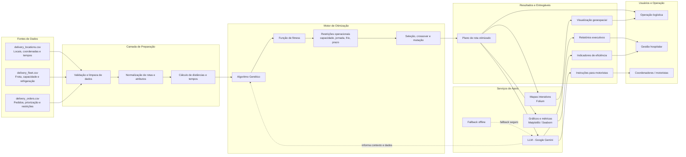

# Diagrama de Arquitetura

A solução foi estruturada como um pipeline de dados e otimização logística, com integração de inteligência artificial para geração de instruções e relatórios.

## Visão Conceitual

- A camada de dados recebe os arquivos CSV com informações dos locais, frota e pedidos.
- A etapa de preparação transforma esses dados em entradas válidas para o problema de roteamento.
- O núcleo do sistema é o algoritmo genético, responsável por otimizar a sequência de entregas respeitando capacidades, prazos e restrições logísticas.
- Os módulos de apoio geram mapas, gráficos e relatórios, além de integrar uma LLM para transformar os resultados em linguagem natural.
- O produto final fornece decisões operacionais acionáveis para gestão, atendimento e execução de entregas.

## Componentes Chave

- Data layer: arquivos de logística e operação hospitalar.
- Optimization engine: lógica de busca e otimização.
- Visualization layer: mapas e dashboards executivos.
- AI layer: geração de instruções e relatórios com Gemini.
- Delivery outputs: rota recomendada, instruções, indicadores e suporte de decisão.
